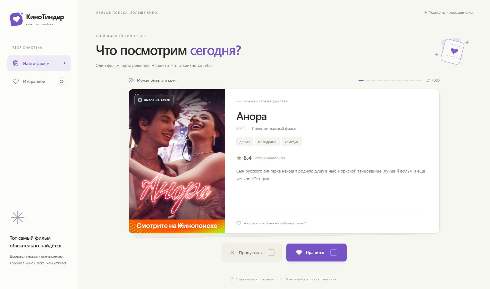

<div align="center">

# КиноТиндер

### Кино по любви.

**Потрать вечер на кино, а не на его поиски.**

Одна карточка. Одно решение. Следующая любимая история.

</div>



## Следующий любимый фильм — в одном свайпе

КиноТиндер помогает выбрать фильм без бесконечного листания каталогов. Посмотри на постер, прочитай короткое описание и доверься первому впечатлению. Нравится — сохрани. Не твоё — переходи дальше.

Всё, что зацепило, останется в личной коллекции до подходящего вечера. Без регистрации, чужих голосов и ожидания совпадений.

## Что уже работает

- До **500 реальных фильмов** из [ПоискКино API](https://poiskkino.dev/): постеры, жанры, год, рейтинг Кинопоиска и описания.
- Автоматическая подгрузка по 50 фильмов при пролистывании, без дубликатов.
- Выбор кнопками, стрелками клавиатуры или свайпом мышью.
- Избранное с добавлением и удалением фильмов.
- Сохранение каталога и избранного в локальной SQLite после перезапуска.
- Светлый интерфейс с плавными переходами.
- HTML, CSS и чистый JavaScript на фронтенде; Flask на бэкенде.

## Скачать и показать другу: Windows

Репозиторий публичный. Для запуска нужны **Python 3.10 или новее**, интернет и действующий ключ [poiskkino.dev](https://poiskkino.dev/). Node.js, отдельный сервер БД и Git для ZIP-версии не нужны.

1. Установи [Python](https://www.python.org/downloads/). В установщике Windows включи **Add python.exe to PATH**.
2. Скачай [ZIP проекта](https://github.com/Z0XX1/tinder-films/archive/refs/heads/main.zip) через **Code → Download ZIP** и распакуй его целиком в отдельную папку.
3. Открой распакованную папку и запусти **`start.bat` двойным щелчком**.
4. При первом запуске скрипт создаст `.venv`, установит зависимости и попросит ключ `POISKKINO_API_KEY`. Вставь свой ключ и нажми Enter. Ввод скрыт: символы не отображаются. Ключ сохранится в `.env` на твоём компьютере.
5. Когда появится `Running on http://127.0.0.1:5000`, открой [приложение](http://127.0.0.1:5000) в браузере. Окно консоли оставь открытым на время показа.

Первое открытие каталога выполняет настоящий запрос к API и сохраняет фильмы в БД. Готового каталога, тестовых фильмов или чужого избранного в скачанном проекте нет.

**Повторный запуск:** снова открой `start.bat`. Ключ повторно вводить не нужно; каталог и избранное останутся на месте. **Остановка:** нажми `Ctrl+C` в консоли.

Ключ в публичный репозиторий не включён. Другу нужен собственный ключ; если используете один ключ для показа, передайте его лично и введите при первом запуске. Публиковать его в README или коммитах не требуется.

## Запуск вручную

Вместо ZIP можно клонировать репозиторий:

```powershell
git clone https://github.com/Z0XX1/tinder-films.git
cd tinder-films
```

В папке проекта выполни:

```powershell
python -m venv .venv
.\.venv\Scripts\python.exe -m pip install -r requirements.txt
.\.venv\Scripts\python.exe setup_env.py
.\.venv\Scripts\python.exe app.py
```

`setup_env.py` запросит ключ, только если он ещё не настроен. Другой способ: скопировать `.env.example` в `.env` и заполнить строку `POISKKINO_API_KEY=твой_ключ`. После изменения `.env` перезапусти Flask.

Для macOS/Linux:

```bash
python3 -m venv .venv
.venv/bin/python -m pip install -r requirements.txt
.venv/bin/python setup_env.py
.venv/bin/python app.py
```

Открывай приложение через Flask по адресу **http://127.0.0.1:5000**. Запуск `index.html` отдельно или через `python -m http.server` не обслуживает API и для показа не подходит.

## Где хранятся данные

Все пути ниже указаны относительно папки, в которой лежит `app.py`. Они не зависят от того, из какой папки терминала запущен сервер.

| Что | Где | Что содержит |
| --- | --- | --- |
| Каталог и избранное | `instance/kinotinder.sqlite3` | Локальная база SQLite, создаётся автоматически при запуске Flask |
| Фильмы | Таблица `movies` в этой БД | ID и JSON с названием, годом, жанрами, рейтингом, описанием и URL постера |
| Избранное | Таблица `favorites` в этой БД | ID фильма и время добавления |
| Прогресс загрузки | Таблица `catalog_state` в этой БД | Курсор следующей страницы API и признак конца каталога |
| API-ключ | `.env` рядом с `app.py` | `POISKKINO_API_KEY`; также поддерживается переменная окружения с этим именем |
| Python-зависимости | `.venv/` | Локально установленное окружение Python |
| Изображения | Внешние URL, полученные от API | Постеры загружаются браузером; файлы изображений в SQLite не сохраняются |

Например, при расположении проекта в `E:\HackATon` база находится в `E:\HackATon\instance\kinotinder.sqlite3`, а ключ — в `E:\HackATon\.env`.

### Когда выполняются запросы к API

1. При запуске Flask создаёт пустую SQLite, если файла БД ещё нет.
2. При первом `GET /api/movies`, если таблица `movies` пуста, сервер запрашивает **50 фильмов** у `https://api.poiskkino.dev/v1.5/movie` и сохраняет результат одной транзакцией.
3. Когда текущие карточки заканчиваются, интерфейс автоматически запрашивает следующую порцию по 50 фильмов через `/api/movies/next`, пока каталог не достигнет **500 уникальных фильмов** или провайдер не сообщит об окончании данных. Повторные ID не добавляются.
4. Курсор API сохраняется в SQLite вместе с фильмами: перезапуск сервера продолжает загрузку с нужной страницы. При ошибке можно повторить запрос, уже загруженные фильмы и избранное сохраняются. Следующие открытия используют локальный каталог; ежедневного автообновления нет. После последней карточки можно посмотреть подборку снова.
5. Добавление и удаление избранного меняют SQLite. `localStorage` для данных приложения не используется.

При обновлении старой версии с 20 фильмами новая таблица создаётся автоматически. Первый дополнительный запрос может повторно получить часть уже сохранённых фильмов: дубликаты будут отсеяны, избранное останется на месте. Удалять старую БД для обновления не нужно.

У друга будет **своя независимая БД**, созданная на его компьютере. Твоё избранное не передаётся через GitHub. В одном запущенном экземпляре список избранного общий для всех браузеров, которые к нему обращаются: аккаунтов нет.

Для резервной копии останови сервер и скопируй файл `instance/kinotinder.sqlite3`. Чтобы полностью сбросить каталог и избранное, останови сервер, сохрани резервную копию и удали этот файл. При следующем запуске база создастся заново, а каталог загрузится из API при открытии приложения.

БД, `.env` и `.venv` исключены из Git. В репозитории есть весь исходный код, зависимости, пример конфигурации, скрипты запуска и тесты. Файл `.env.example` входит в ZIP и содержит только пустой шаблон ключа.

## Сценарий показа

1. Запусти `start.bat` и открой приложение.
2. Покажи карточку: постер, год, жанры, рейтинг и описание из API.
3. Нажми «Нравится», затем пропусти следующий фильм кнопкой или свайпом.
4. Открой «Избранное»: понравившийся фильм уже там.
5. Пролистай текущую порцию: следующая загрузится автоматически. Счётчик показывает продвижение к 500 фильмам.
6. Перезагрузи страницу, затем перезапусти сервер: избранное сохранится в SQLite.
7. Удали фильм из избранного и покажи обновившийся список.

## Если что-то не запускается

| Проблема | Что сделать |
| --- | --- |
| Python не найден | Установить Python 3.10+ с опцией Add to PATH и снова открыть `start.bat` |
| Не устанавливаются зависимости | Проверить интернет и сообщение `pip` в окне консоли |
| API отклонил ключ | Проверить `POISKKINO_API_KEY` в `.env` и перезапустить сервер |
| Лимит API исчерпан | Подождать восстановления лимита или использовать другой действующий ключ |
| Страница не открывается | Проверить, что консоль Flask открыта и адрес — `http://127.0.0.1:5000` |
| Порт 5000 занят | Остановить ранее запущенный экземпляр Flask и повторить запуск |
| Нет постеров | Проверить доступ к внешним адресам изображений и подключение к интернету |

## Структура проекта

```text
start.bat              # Запуск на Windows: окружение, зависимости, ключ, Flask
setup_env.py           # Первичная настройка ключа без его вывода на экран
app.py                 # Flask, ПоискКино API и SQLite
requirements.txt       # Зафиксированные версии зависимостей
.env.example           # Пример конфигурации без ключа
frontend/
  index.html           # Разметка
  style.css            # Дизайн
  script.js            # Интерфейс и свайпы
  api.js               # Запросы к Flask
docs/preview.jpg       # Скриншот приложения
tests/                 # Проверки API, SQLite и настройки ключа
instance/              # Создаётся локально; не входит в репозиторий
  kinotinder.sqlite3
```

## API приложения

| Метод | Адрес | Назначение |
| --- | --- | --- |
| GET | `/api/movies` | Каталог из SQLite; при пустой БД — импорт из ПоискКино |
| GET | `/api/movies/next` | Следующая порция из API; ответ с новыми фильмами и метаданными |
| GET | `/api/favorites` | Массив избранных фильмов |
| POST | `/api/favorites` | Добавить: JSON `{ "movie_id": 123 }` |
| DELETE | `/api/favorites/123` | Удалить из избранного, ответ `204` |

`GET /api/movies` и `GET /api/favorites` возвращают массивы объектов единого формата:

```js
{ id, title, year, genres, rating, poster, description }
```

`GET /api/movies/next` возвращает `{ movies, has_more, total, limit }`: только новые фильмы в `movies`, возможность продолжения, число сохранённых уникальных фильмов и предел `500`. После достижения предела повторных внешних запросов нет. При ошибке API курсор не меняется.

`genres` — массив строк, `rating` и `year` могут быть `null`. POST принимает ID из локального каталога и возвращает объект фильма. Повторное добавление не создаёт дубликаты. Ошибки возвращаются как JSON `{ "error": "Сообщение" }` с HTTP-статусом ошибки.

Ключ передаётся провайдеру только сервером в заголовке `X-API-KEY`. Фронтенд обращается к Flask, а не к ПоискКино напрямую. По умолчанию сервер доступен на этом компьютере по `127.0.0.1`; отдельный хостинг для локального показа не нужен.

## Проверки

```powershell
.\.venv\Scripts\python.exe -m unittest discover -s tests -v
```

Тесты используют временные файлы и временную SQLite, а внешний HTTP-ответ подменяется. Рабочая БД и личный ключ не меняются. Проверяются также 500 уникальных фильмов, курсоры после перезапуска, повтор после ошибки и обновление старой БД.

---

**Меньше поиска. Больше кино.**
